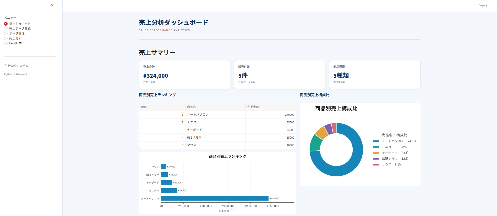
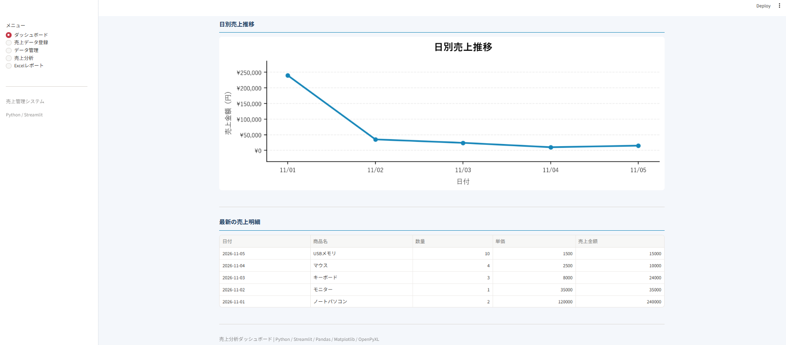
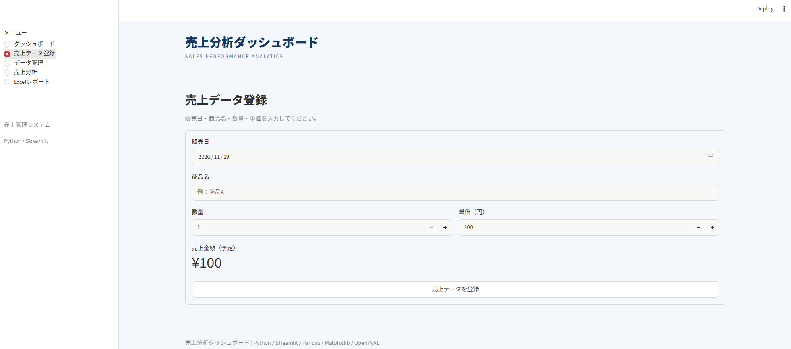
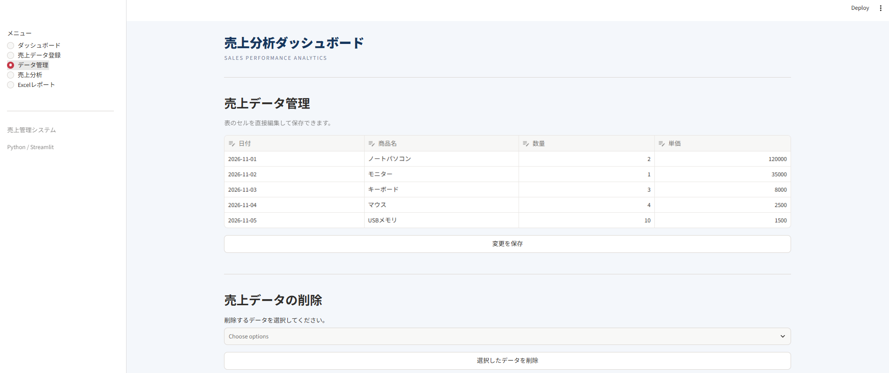
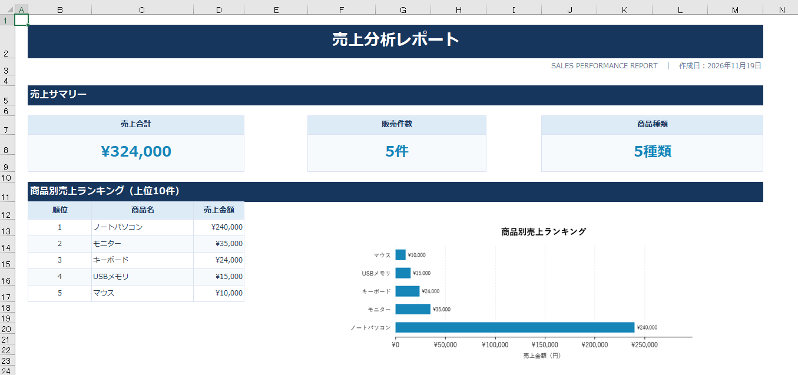
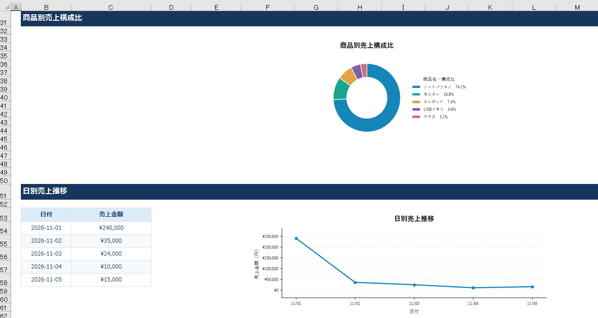
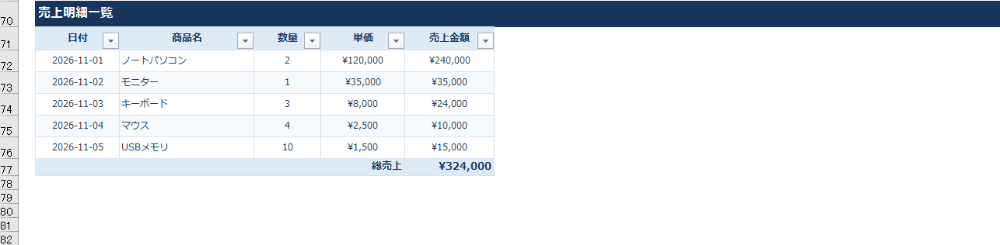

# 売上分析・管理システム

PythonとStreamlitを使用して開発した、売上データの登録・管理・分析を行うWebアプリケーションです。

売上データの登録から、商品別売上ランキングや日別売上推移の可視化、Excelレポートの出力まで、一連の売上管理業務を行えるシステムを作成しました。

---

## アプリ画面

### 1. 売上分析ダッシュボード

売上合計・販売件数・商品種類などの集計情報を表示します。

商品別売上ランキングや売上構成比、日別売上推移をグラフで確認できます。





### 2. 売上データ登録

販売日・商品名・数量・単価を入力し、新しい売上データを登録できます。

売上金額は数量と単価から自動計算されます。



### 3. 売上データ管理

登録済みの売上データを一覧表示し、内容の編集・保存・削除ができます。



### 4. Excelレポート出力

売上データをもとにExcel形式の売上分析レポートを作成できます。

売上サマリー、商品別売上ランキング、商品別売上構成比、日別売上推移、売上明細一覧を出力します。







---

## 主な機能

| 機能 | 内容 |
|---|---|
| ダッシュボード | 売上合計・販売件数・商品種類の表示 |
| 売上データ登録 | 販売日・商品名・数量・単価の登録 |
| データ管理 | 登録データの編集・保存・削除 |
| 売上分析 | 商品別売上ランキング・売上構成比・日別売上推移の可視化 |
| Excelレポート | 集計結果やグラフを含むExcelファイルの出力 |
| CSVデータ管理 | CSVファイルを使用した売上データの管理 |

---

## 使用技術

| 技術 | 用途 |
|---|---|
| Python | アプリケーション開発 |
| Streamlit | Webアプリケーションの画面構築 |
| Pandas | 売上データの集計・加工 |
| Matplotlib | グラフの作成 |
| OpenPyXL | Excelファイルの作成・書式設定 |
| CSV | 売上データの保存・読み込み |

---

## ファイル構成

```text
sales-management-system/
│
├── app.py
├── main.py
├── requirements.txt
├── README.md
│
├── sales_app.csv
├── sales_app_sample.csv
│
└── images/
    ├── dashboard_1.png
    ├── dashboard_2.png
    ├── data_management.png
    ├── data_registration.png
    ├── excel_report_1.png
    ├── excel_report_2.png
    └── excel_report_3.png
```

---

## 実行方法

### 1. リポジトリをクローン

```bash
git clone リポジトリのURL
```

### 2. プロジェクトフォルダへ移動

```bash
cd sales-management-system
```

### 3. 必要なライブラリをインストール

```bash
pip install -r requirements.txt
```

### 4. アプリケーションを起動

```bash
streamlit run main.py
```

ブラウザが起動し、売上管理システムを利用できます。

---

## 工夫した点・開発で取り組んだこと

- 売上データの登録・編集・削除を一つのアプリケーションに集約しました。
- 数量と単価から売上金額を自動計算する仕組みを実装しました。
- Pandasを使用して商品別・日別の売上データを集計しました。
- Matplotlibを使用して売上データをグラフで可視化しました。
- OpenPyXLを使用して、見やすさを意識したExcelレポートを作成しました。
- CSVの読み込み時に入力値をチェックし、不正なデータを処理する仕組みを実装しました。

---

## 開発環境

- Python
- Visual Studio Code
- Windows

## 開発目的

Pythonによるデータ処理やWebアプリケーション開発の学習を目的として制作しました。

データの登録・管理だけでなく、集計・分析・Excel出力まで実装することで、実際の業務を意識したアプリケーション開発に取り組みました。